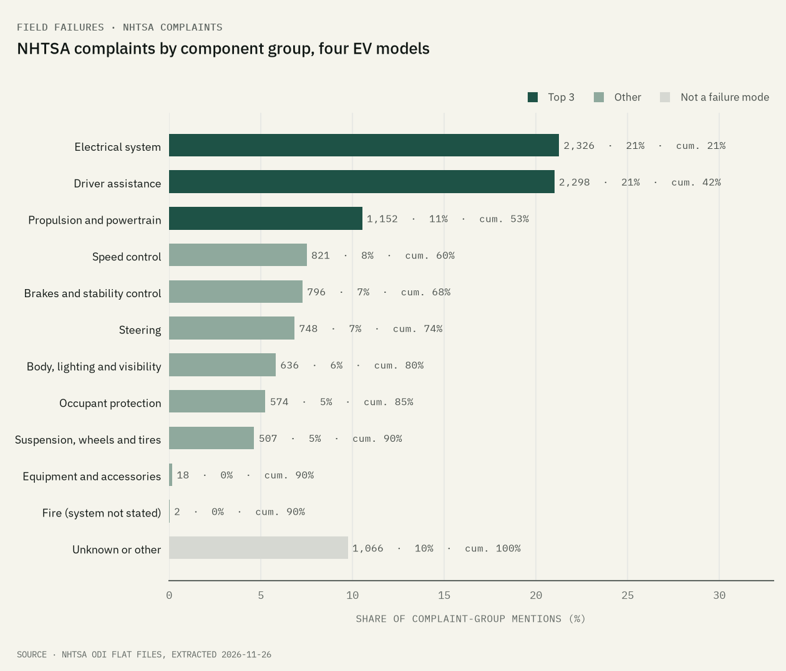
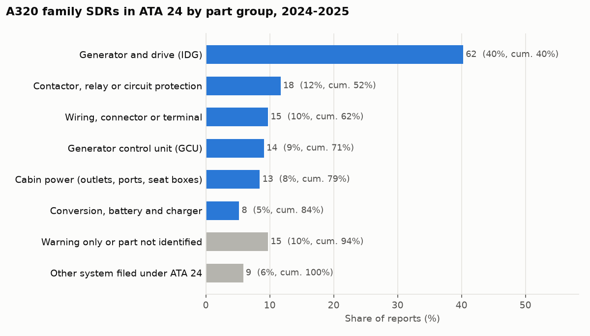
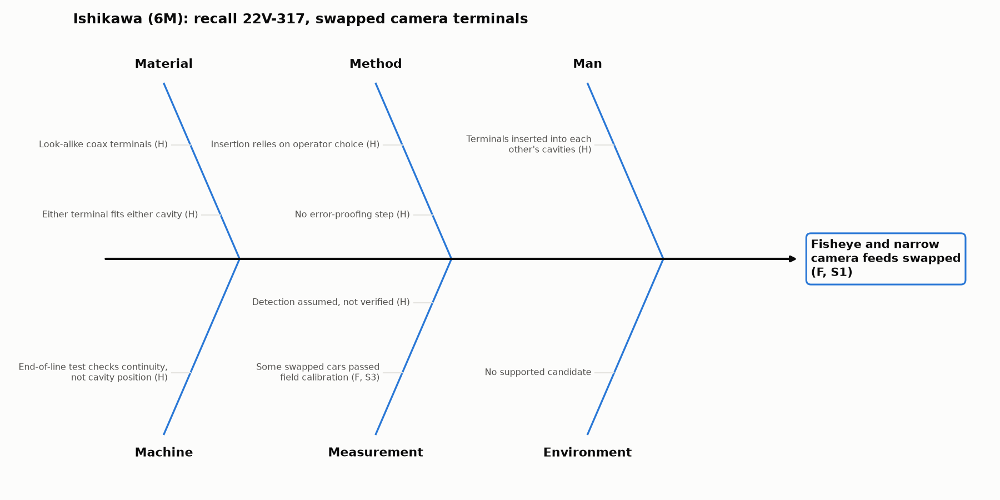
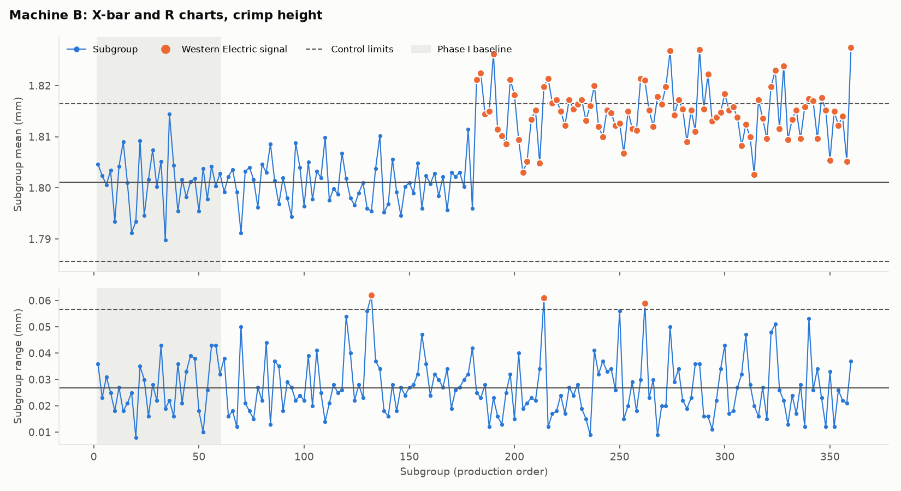

# Field failure intelligence and crimping SPC

Technical design and backlog map: [docs/BLUEPRINT.md](docs/BLUEPRINT.md).

**Status: v0.1.** Field failure analysis (NHTSA and FAA data, Pareto charts) and an 8D on a real recall are done. The process side (crimp height simulator, SPC, capability, Gage R&R, PFMEA, control plan and app) comes in v1.0.

## Business question

Which failure modes dominate the field in vehicle and aircraft electrical systems, and is the terminal crimping process that can cause them capable and in control?

**Decision supported:** whether the crimping process can be released as is, which characteristics need tighter control, and what the control plan should require.

### Problem statement

1. Electric vehicles and aircraft depend on wiring and connectors, and poor terminals show up in service as intermittent connections, overheating and loss of power.
2. Public field data exist (NHTSA complaints and recalls, FAA Service Difficulty Reports) but are spread out, loosely coded and rarely tied back to a manufacturing process.
3. This project ranks the dominant electrical failure modes for four electric vehicle models and one aircraft family, and runs an 8D on one real recall.
4. It then follows the chosen failure mode to its process cause, crimp height, and tests on simulated data whether the crimping process is stable, capable and measured by an adequate gauge.
5. The output is a PFMEA and a control plan that say which characteristics to control, how often to sample and how to react.

### Scope

| Source | Filter |
|---|---|
| NHTSA complaints and recalls | Hyundai Ioniq 5, Ford Mustang Mach-E, Tesla Model 3, Chevrolet Bolt EV |
| FAA Service Difficulty Reports | Airbus A320 family, ATA chapter 24 (electrical power), 2 years |

### KPIs and acceptance

| KPI | Definition | Target / check |
|---|---|---|
| Pareto concentration | Share of the top 3 failure modes in the field reports | Reported per data source |
| Process capability | Cpk of crimp height after removing special causes | ≥ 1.33 to accept; below that, action required |
| Measurement system | %GRR (share of study variation) | < 10% accept; 10–30% conditional, accepted only with a justification such as cost of the gauge or criticality; > 30% reject |
| Distinct categories | ndc of the Gage R&R study | ≥ 5 |
| Detection quality | Share of injected special causes flagged by the charts | All injected shifts flagged; false alarm rate reported |

## Result

### Summary so far

- In the field data, the electrical system is the largest component group for the four electric vehicles (21% of complaint mentions, 31% of recall campaigns), and the AC generator and its drive dominate A320 family reports in ATA chapter 24.
- Wiring, connector and terminal problems are a small but steady share in both sources: 6% of EV electrical complaints and 10% of A320 ATA 24 reports by part.
- The 8D on recall 22V-317 shows a harness defect (terminals in the wrong connector cavities) that escaped because a detection barrier was assumed and not measured. The v1.0 work measures the crimping process and its gauge instead of assuming them.

### Field failures (NHTSA, four EV models)

Notebook: [notebooks/01_field_failures.ipynb](notebooks/01_field_failures.ipynb). Tables: [reports/tables](reports/tables).

| Pareto | Top 3 | Top 3 share |
|---|---|---:|
| Complaints by component group (10,944 complaint-group mentions) | Electrical system, Driver assistance, Propulsion and powertrain | 52.8% |
| Recall campaigns by component group (87 campaigns) | Electrical system, Body, lighting and visibility, Occupant protection | 64.2% |
| Electrical complaints by failure mode (2,326 complaints) | Charging unit (ICCU / DC-DC / onboard charger), Display, software and controls, High-voltage battery or contactor | 50.4% |

- The electrical system is the largest group in both complaints (21%) and recall campaigns (31%).
- Within electrical complaints, the charging unit (ICCU) leads with 30%, and 698 of these 699 complaints are on the Ioniq 5.
- Wiring, connector or terminal problems are 6% of electrical complaints (132); thermal events (burning, smoke, fire) are another 7%, led by the Bolt EV (93 of 155).
- By model year (years with at least 30 complaints), the share of complaints naming the electrical system is 71–79% for the Ioniq 5 (2022–2025), 41–65% for the Mach-E and 29–54% for the Bolt EV, against 8–21% for the Model 3.




### Field failures (FAA SDR, Airbus A320 family, ATA 24)

154 Service Difficulty Reports in 2024–2025 for the A318–A321 (neo included) in chapter 24, electrical power.

| Pareto | Top 3 | Top 3 share |
|---|---|---:|
| By JASC subsystem | 2421 AC generator-alternator, 2497 Electrical power system wiring, 2400 Electrical power system | 82.5% |
| By part group | Generator and drive (IDG), Contactor, relay or circuit protection, Wiring, connector or terminal | 61.7% |

- The AC generator-alternator (JASC 2421) alone holds 58% of the reports; by part, the IDG and generator hold 40% and the generator control unit another 9%.
- Wiring, connectors and terminals are 10% of the reports by part (15), and JASC 2497 (power system wiring) is 16% (24): the wiring code also carries reports whose part is not named.
- 16% of the reports (24) name only a warning message, no part, or a part from another system filed under chapter 24; they stay in the denominator.



### 8D on a real recall

[reports/8D.pdf](reports/8D.pdf) (source: [reports/8D.md](reports/8D.md)) works through D1–D8 on NHTSA recall 22V-317: on 7 Tesla Model 3 and Model Y vehicles, the fisheye and narrow camera terminals were installed into each other's cavities in the harness connector, swapping the camera views. Every statement is tagged as published fact (with a link to the Part 573 report, chronology or service bulletin), hypothesis or study assumption.

- **Occurrence (published):** terminals installed in the wrong cavities during the supplier's harness manufacturing.
- **Escape (published chronology):** an investigation was closed in Feb 2021 on the assessment that affected cars could not pass field camera calibration; in Feb 2022 some had passed.
- **Most likely root cause (hypothesis):** interchangeable terminals with no error-proofing, tests that check continuity but not cavity position, and a detection assumption that was not verified.



### SPC: X-bar and R charts on simulated crimp height

Notebook: [notebooks/02_spc_capability.ipynb](notebooks/02_spc_capability.ipynb). Signal log: [reports/tables/spc_signal_log.csv](reports/tables/spc_signal_log.csv).

Limits per machine from a Phase I baseline (first 5 days, 30 subgroups of 5), then all 180 subgroups per machine checked with the four Western Electric rules.

| Machine | X-bar center (mm) | X-bar limits (mm) | R-bar (mm) | R UCL (mm) | X-bar signals | R signals |
|---|---:|---|---:|---:|---:|---:|
| A | 1.8013 | 1.7855 – 1.8172 | 0.0274 | 0.0580 | 8 | 3 |
| B | 1.8011 | 1.7857 – 1.8165 | 0.0267 | 0.0565 | 90 | 3 |

- Machine B: from subgroup 182 (day 16, shift 1) the X-bar chart fires on all 90 machine B subgroups through the end of the run, starting with a point above the upper limit; before subgroup 182 it fires on none.
- Machine A: 8 scattered X-bar signals (1 inside the baseline), with no sustained pattern.
- R chart: all 6 range signals, on both machines, fall on shift 3. Grouping ranges by shift gives sigma estimates on shift 3 of 1.66× (A) and 1.39× (B) those of shift 1; shift 2 stays within 5% of shift 1.
- Which signals are special causes and which are false alarms is scored against the simulated truth in the capability step (#10).



## Data

Sources, extraction dates and licenses: [data/README.md](data/README.md).

**NHTSA field data** (flat files extracted 2026-11-26, `python -m src.data.download_nhtsa`):

| Vehicle | Complaints | Recall campaigns |
|---|---:|---:|
| Tesla Model 3 | 4,433 | 36 |
| Hyundai Ioniq 5 | 1,362 | 15 |
| Chevrolet Bolt EV | 996 | 14 |
| Ford Mustang Mach-E | 692 | 22 |
| **Total** | **7,483** | **87** |

A complaint can name several components, so the 7,483 complaints make 12,837 complaint-component rows.

**FAA SDR** (yearly files for 2024 and 2025, extracted 2026-11-26, `python -m src.data.download_faa_sdr`): 154 reports for the Airbus A318–A321 with JASC codes 24xx (90 in 2024, 64 in 2025).

**Simulated crimp height** (`python -m src.simulate.crimp`, seeded): 1,800 parts from 2 machines, 3 shifts and 30 days in subgroups of 5, spec 1.80 ± 0.05 mm, with two special causes injected and kept out of the analysis table. Details: [data/README.md](data/README.md#simulated-crimp-height).

**Recall 22V-317 documents** (Part 573 reports, chronology, service bulletin) for the 8D: listed with links in [reports/8D.md](reports/8D.md).

## Method

- **Component taxonomy:** the NHTSA top-level system (text before the first colon) is mapped to 11 groups plus "Unknown or other" ([data/mappings/component_taxonomy.csv](data/mappings/component_taxonomy.csv)). An unmapped system stops the analysis.
- **Counting:** a complaint counts once in every group it names; Pareto shares are shares of these complaint-group mentions. "Unknown or other" and "Not coded" stay in the denominator and are excluded from the top 3.
- **Electrical failure modes:** coded from the complaint narrative with ordered keyword rules, first match wins ([data/mappings/electrical_failure_modes.csv](data/mappings/electrical_failure_modes.csv)).
- **FAA SDR:** reports filtered to the A320 family and JASC codes 24xx; Pareto by JASC subsystem (official titles, [data/mappings/jasc_ata24.csv](data/mappings/jasc_ata24.csv)) and by part group ([data/mappings/sdr_part_groups.csv](data/mappings/sdr_part_groups.csv)).
- **SPC:** X-bar and R limits from R-bar with the NIST factors A2, D3, D4 ([NIST/SEMATECH e-Handbook 6.3.2.1](https://www.itl.nist.gov/div898/handbook/pmc/section3/pmc321.htm)); d2 by numerical integration, checked against NIST's A2 for n = 2–10. Western Electric rules 1–4 on the X-bar chart; rule 1 and the 8-point run on the R chart.
- **Trend by model year:** share of each model year's complaints that name the electrical system, because sales volumes are not available to compute rates.

## Limitations

- Complaints are self-reported and not verified by NHTSA; counts reflect owner reporting behavior as well as defects.
- Without sales or fleet data, complaint counts are not failure rates. Recent model years have had less time in service.
- The SDR sample is small (154 reports in two years) and depends on what operators choose to report and how they code it; several chapter 24 reports concern other systems.
- Keyword coding of narratives is a first pass: 25% of electrical complaints stay "Not coded", and a spot check found charging-cable complaints in the "Wiring, connector or terminal" bucket.

## How to run

```bash
python -m venv .venv
source .venv/Scripts/activate   # Windows Git Bash; use .venv/bin/activate on macOS/Linux
pip install -r requirements.txt
nbstripout --install            # once per clone: strips notebook outputs on commit
```

Reproduce the v0.1 results (downloads about 285 MB into `data/raw/`, which is git-ignored):

```bash
python -m src.data.download_nhtsa      # NHTSA complaints and recalls -> data/processed/
python -m src.data.download_faa_sdr    # FAA SDR, A320 family, ATA 24 -> data/processed/
jupyter nbconvert --to notebook --execute --inplace notebooks/01_field_failures.ipynb
python -m src.reports.build_8d         # Ishikawa figure and reports/8D.pdf from reports/8D.md
python -m src.simulate.crimp           # simulated crimp height -> data/simulated/
```

The notebook writes the figures to `reports/figures/` and the Pareto tables to `reports/tables/`.

Before committing:

```bash
ruff check .
ruff format .
pytest
```

## How AI was used

- **Claude (Claude Code)** wrote the extraction scripts, the analysis and chart code, the tests and the first draft of the README and of the 8D, and checked every number in the README against the generated tables.
- **I** chose the scope (the four vehicles, the A320 family, the recall for the 8D), approved each download of public data, and reviewed and merged every change through a pull request.
- **Judgment calls open to review:** the component taxonomy, the keyword rules for electrical failure modes, the SDR part groups and the hypotheses in the 8D (tagged [H]) were drafted with Claude and are published in the repository so they can be checked and changed.
