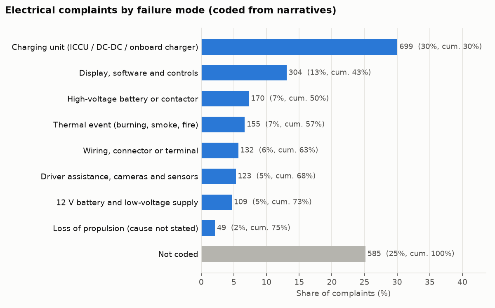
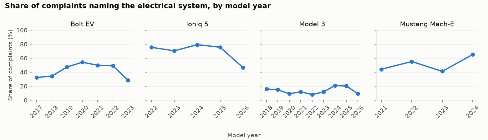

# Field failure intelligence and crimping SPC

Technical design and backlog map: [docs/BLUEPRINT.md](docs/BLUEPRINT.md).

## Business question

Which failure modes dominate the field in vehicle and aircraft electrical systems, and is the terminal crimping process that can cause them capable and in control?

**Decision supported:** whether the crimping process can be released as is, which characteristics need tighter control, and what the control plan should require.

### Problem statement

1. Electric vehicles and aircraft depend on wiring and connectors, and poor terminals show up in service as intermittent connections, overheating and loss of power.
2. Public field data exist (NHTSA complaints and recalls, FAA Service Difficulty Reports) but are spread out, loosely coded and rarely tied back to a manufacturing process.
3. This project ranks the dominant electrical failure modes for four electric vehicle models and one aircraft family, and runs an 8D on one real recall.
4. It then follows the chosen failure mode to its process cause, crimp height, and tests on simulated data whether the crimping process is stable, capable and measured by an adequate gauge.
5. The output is a PFMEA and a control plan that say which characteristics to control, how often to sample and how to react.

### Scope

| Source | Filter |
|---|---|
| NHTSA complaints and recalls | Hyundai Ioniq 5, Ford Mustang Mach-E, Tesla Model 3, Chevrolet Bolt EV |
| FAA Service Difficulty Reports | Airbus A320 family, ATA chapter 24 (electrical power), 2 years |

### KPIs and acceptance

| KPI | Definition | Target / check |
|---|---|---|
| Pareto concentration | Share of the top 3 failure modes in the field reports | Reported per data source |
| Process capability | Cpk of crimp height after removing special causes | ≥ 1.33 to accept; below that, action required |
| Measurement system | %GRR (share of study variation) | < 10% accept; 10–30% conditional, accepted only with a justification such as cost of the gauge or criticality; > 30% reject |
| Distinct categories | ndc of the Gage R&R study | ≥ 5 |
| Detection quality | Share of injected special causes flagged by the charts | All injected shifts flagged; false alarm rate reported |

## Result

### Field failures (NHTSA, four EV models)

Notebook: [notebooks/01_field_failures.ipynb](notebooks/01_field_failures.ipynb). Tables: [reports/tables](reports/tables).

| Pareto | Top 3 | Top 3 share |
|---|---|---:|
| Complaints by component group (10,944 complaint-group mentions) | Electrical system, Driver assistance, Propulsion and powertrain | 52.8% |
| Recall campaigns by component group (87 campaigns) | Electrical system, Body, lighting and visibility, Occupant protection | 64.2% |
| Electrical complaints by failure mode (2,326 complaints) | Charging unit (ICCU / DC-DC / onboard charger), Display, software and controls, High-voltage battery or contactor | 50.4% |

- The electrical system is the largest group in both complaints (21%) and recall campaigns (31%).
- Within electrical complaints, the charging unit (ICCU) leads with 30%, and 698 of these 699 complaints are on the Ioniq 5.
- Wiring, connector or terminal problems are 6% of electrical complaints (132); thermal events (burning, smoke, fire) are another 7%, led by the Bolt EV (93 of 155).
- By model year (years with at least 30 complaints), the share of complaints naming the electrical system is 71–79% for the Ioniq 5 (2022–2025), 41–65% for the Mach-E and 29–54% for the Bolt EV, against 8–21% for the Model 3.






## Data

Sources, extraction dates and licenses: [data/README.md](data/README.md).

**NHTSA field data** (flat files extracted 2026-11-26, `python -m src.data.download_nhtsa`):

| Vehicle | Complaints | Recall campaigns |
|---|---:|---:|
| Tesla Model 3 | 4,433 | 36 |
| Hyundai Ioniq 5 | 1,362 | 15 |
| Chevrolet Bolt EV | 996 | 14 |
| Ford Mustang Mach-E | 692 | 22 |
| **Total** | **7,483** | **87** |

A complaint can name several components, so the 7,483 complaints make 12,837 complaint-component rows.

## Method

- **Component taxonomy:** the NHTSA top-level system (text before the first colon) is mapped to 11 groups plus "Unknown or other" ([data/mappings/component_taxonomy.csv](data/mappings/component_taxonomy.csv)). An unmapped system stops the analysis.
- **Counting:** a complaint counts once in every group it names; Pareto shares are shares of these complaint-group mentions. "Unknown or other" and "Not coded" stay in the denominator and are excluded from the top 3.
- **Electrical failure modes:** coded from the complaint narrative with ordered keyword rules, first match wins ([data/mappings/electrical_failure_modes.csv](data/mappings/electrical_failure_modes.csv)).
- **Trend by model year:** share of each model year's complaints that name the electrical system, because sales volumes are not available to compute rates.

## Limitations

- Complaints are self-reported and not verified by NHTSA; counts reflect owner reporting behavior as well as defects.
- Without sales or fleet data, complaint counts are not failure rates. Recent model years have had less time in service.
- Keyword coding of narratives is a first pass: 25% of electrical complaints stay "Not coded", and a spot check found charging-cable complaints in the "Wiring, connector or terminal" bucket.

## How to run

```bash
python -m venv .venv
source .venv/Scripts/activate   # Windows Git Bash; use .venv/bin/activate on macOS/Linux
pip install -r requirements.txt
nbstripout --install            # once per clone: strips notebook outputs on commit
```

Before committing:

```bash
ruff check .
ruff format .
pytest
```

## How AI was used
