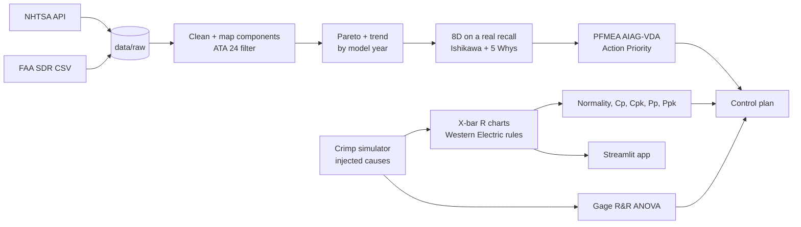

# Blueprint: Field failure intelligence and crimping SPC

Technical design for this project. The backlog lives in the [epic](https://github.com/stephanyalves-eng/p2-field-failure-spc/issues/1); each section below names the issues that deliver it.

## 1. Business question

Which failure modes dominate the field in vehicle and aircraft electrical systems, and is the terminal crimping process that can cause them capable and in control?

**Decision supported:** whether the crimping process can be released as is, which characteristics need tighter control, and what the control plan should require.

**Why this closes a loop:** it connects field data (what fails in service) to root cause analysis (8D) and to manufacturing control (SPC, MSA, PFMEA), the cycle that IATF 16949 and AS9100 quality teams run every day. Crimp height is a classic critical characteristic in harnesses and connectors.

## 2. Scope

| In scope | Out of scope |
|---|---|
| NHTSA complaints and recalls for 2–3 electric vehicle models | Proprietary warranty data |
| FAA SDR reports for one aircraft model, ATA chapter 24 | Failure prediction with machine learning (stretch only) |
| One 8D on a real public recall, with fact vs. hypothesis marked | Claims about a manufacturer beyond what it published |
| Simulated crimp height process, SPC, capability, Gage R&R, PFMEA, control plan | Real plant measurements |
| Streamlit app that charts any uploaded CSV | |

## 3. KPIs and acceptance

| KPI | Definition | Target / check |
|---|---|---|
| Pareto concentration | Share of the top 3 failure modes in field reports | Reported per data source |
| Process capability | Cpk of crimp height after removing special causes | ≥ 1.33 to accept; below that, action required |
| Measurement system | %GRR (study variation) and ndc | %GRR < 10% accept, 10–30% conditional, > 30% reject; ndc ≥ 5 |
| Detection quality | Share of injected special causes flagged by the charts | All injected shifts flagged; false alarm rate reported |

## 4. Data sources

| Source | What it provides | Access | License | Script |
|---|---|---|---|---|
| [NHTSA Datasets and APIs](https://www.nhtsa.gov/nhtsa-datasets-and-apis) | Recalls and owner complaints by make, model, year and component | Public API and zip files | Public domain | `src/data/download_nhtsa.py` |
| NHTSA manufacturer defect reports (Part 573) | Root cause and remedy text for one recall | Public PDF per campaign | Public domain | Linked in `data/README.md` |
| [FAA Service Difficulty Reports](https://www.faa.gov/av-info/download_SDR) | Failures and malfunctions reported by operators and repair stations | Yearly CSV | Public | `src/data/download_faa_sdr.py` |
| Process simulator | Crimp height by machine, shift, day and subgroup | `src/simulate/crimp.py` | Generated, MIT | Seeded, true parameters saved |
| Optional: UCI SECOM | Semiconductor process data with fail labels (~1,500 rows) | Direct download | CC BY 4.0 | Stretch only |

## 5. Pipeline



The link that makes this one project: the field failure mode chosen in the Pareto (for example, intermittent connection or overheating at a terminal) becomes the failure mode in the PFMEA, and its process cause is the crimp height deviation that the simulator models.

## 6. Method by stage

| Stage | Issues | Method | Output |
|---|---|---|---|
| Framing | #2 | KPIs and acceptance rules above; choose the vehicle and aircraft models | `README.md` business question |
| Field failures | #3, #4, #5 | NHTSA complaints and recalls by component; Pareto and trend by model year; FAA SDR for 2 years, ATA 24, Pareto by part | `notebooks/01_field_failures.ipynb` |
| 8D | #6 | D1–D8 on one public wiring or connector recall, with Ishikawa (6M) and 5 Whys; every field marked as published fact or my hypothesis | `reports/8D.pdf` |
| v0.1 | #7 | Partial README with field findings | v0.1 release |
| Process simulation | #8 | Crimp height spec 1.80 ± 0.05 mm, 2 machines, 3 shifts, 30 days, subgroups of 5; inject a mean shift on machine B after a tool change and higher variance on shift 3; save the true parameters | `src/simulate/crimp.py`, CSV |
| SPC | #9 | X-bar and R charts per machine with Western Electric rules | Charts, signal log |
| Capability | #10 | Normality test; Cp, Cpk, Pp, Ppk before and after removing special causes; detection and false alarm rate against the simulated truth | Capability table |
| MSA | #11 | Crossed Gage R&R by ANOVA: 10 parts, 3 operators, 3 trials; %GRR and ndc; accept or reject the gauge | MSA report |
| PFMEA and control plan | #12 | AIAG-VDA 7-step PFMEA with Action Priority (H, M, L); control plan linking each characteristic to SPC sampling and reaction plan | `reports/PFMEA.xlsx`, control plan |
| App and delivery | #13, #14 | Streamlit app: upload a CSV, get control charts and Cpk; case study | Published app, v1.0 release |

## 7. Repository layout

```
src/
  data/download_nhtsa.py
  data/download_faa_sdr.py
  simulate/crimp.py            # process simulator with injected causes
  spc.py                       # control limits, Western Electric rules
  capability.py                # Cp, Cpk, Pp, Ppk
  msa.py                       # crossed Gage R&R by ANOVA
app/streamlit_app.py
notebooks/
  01_field_failures.ipynb
  02_spc_capability.ipynb
  03_msa.ipynb
reports/8D.pdf, PFMEA.xlsx, control_plan.xlsx
tests/                         # known-answer tests for SPC, capability and MSA
```

## 8. Validation and tests

- **Known-answer tests:** control limits and Cpk checked against a textbook example (NIST e-Handbook chapter 6) to the second decimal.
- **Truth recovery:** the charts must flag the machine B shift within a few subgroups of the tool change and show the variance increase on shift 3; capability after removing special causes must move toward the simulated true Cpk.
- **Gage R&R check:** the ANOVA variance components must sum to the total and reproduce a published worked example.
- **8D honesty check:** every D-step field has a fact or hypothesis tag and a source link for facts.
- CI runs `ruff check`, `ruff format --check` and `pytest` on every PR.

## 9. Deliverables and releases

| Release | Milestone | Content |
|---|---|---|
| v0.1 | Sprint 3 (ends 20 Dec 2026) | Field failure base, Paretos, 8D |
| v1.0 | Sprint 4 (ends 17 Jan 2027) | Simulator, SPC, capability, Gage R&R, PFMEA, control plan, Streamlit app, case study |

## 10. Assumptions and risks

| Item | Mitigation |
|---|---|
| NHTSA component labels are broad and inconsistent | Map to a small component taxonomy and publish the mapping table |
| FAA SDR files are large and loosely formatted | Filter early by aircraft model and ATA 24; keep only needed columns |
| The 8D could read as an accusation | Use only the manufacturer's published report and tag every inference as hypothesis |
| PFMEA ratings are subjective | Write the reason for each severity, occurrence and detection rating |

## 11. Stretch

Failure classification on UCI SECOM (feature selection and logistic regression) as a bridge to quality analytics roles.

## 12. Division of work with AI

Claude writes the simulator and the chart code. PFMEA ratings and the reading of SPC signals are engineering judgment: I make them and justify them in writing.
