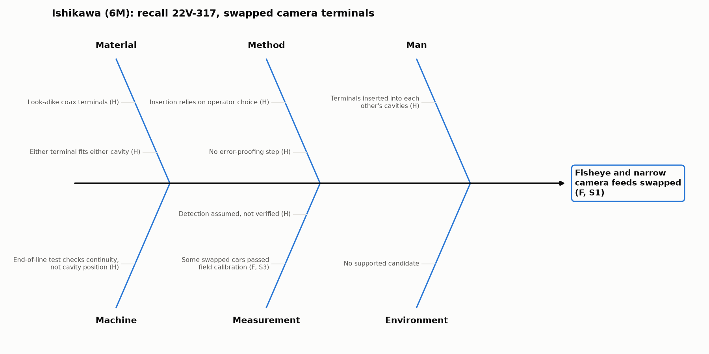

# 8D report: swapped camera feeds from terminals installed in the wrong connector cavities

**Recall:** NHTSA 22V-317 (manufacturer recall SB-22-17-007), Tesla Model 3 and Model Y.

**Purpose:** a study 8D written from public documents only. It is not the manufacturer's 8D and does not claim to know more than the manufacturer published.

## How to read this report

Every statement carries one tag:

- **[F]** published fact, with the source in brackets, for example [F, S2].
- **[H]** my hypothesis or engineering judgment. It is not confirmed by any source.
- **[A]** study assumption, needed to fill an 8D step that public documents do not cover.

Sources (all downloaded on 2026-11-26 from the NHTSA recall page https://www.nhtsa.gov/?nhtsaId=22V317000):

| Id | Document | Link |
|---|---|---|
| S1 | Part 573 Safety Recall Report, submitted May 9, 2022 | https://static.nhtsa.gov/odi/rcl/2022/RCLRPT-22V317-5187.PDF |
| S2 | Part 573 Safety Recall Report, amendment 2, submitted Jul 14, 2022 | https://static.nhtsa.gov/odi/rcl/2022/RCLRPT-22V317-7162.PDF |
| S3 | Chronology of Defect Determination, Jul 14, 2022 | https://static.nhtsa.gov/odi/rcl/2022/RMISC-22V317-6260.pdf |
| S4 | Service Bulletin SB-22-17-007, "Swap Triple Camera Coax Cables", May 16, 2022 | https://static.nhtsa.gov/odi/rcl/2022/RCRIT-22V317-4389.pdf |

## Why this recall

- It is a harness manufacturing defect: two terminals installed into the wrong cavities of a connector [F, S1]. That is the same family of process as the terminal crimping studied in the rest of this project (cut, strip, crimp, insert, test).
- Driver assistance is the largest component group in this project's Model 3 complaints (1,978 complaint-group mentions; see [notebooks/01_field_failures.ipynb](../notebooks/01_field_failures.ipynb)), so the effect of the defect sits in the group owners report most often.
- The published chronology shows a containment that was closed and later reopened, which makes the escape point (D4) and the prevention step (D7) worth studying.

## D1. Team

| Role | Why it is needed |
|---|---|
| Harness supplier process engineer | Owns terminal insertion and the harness end-of-line test [A] |
| Vehicle plant quality engineer | Owns camera installation and production calibration [A] |
| Autopilot / camera systems engineer | Knows what the system can and cannot detect [A] |
| Field service engineer | Owns warranty data and the field remedy [A] |
| Supplier quality engineer (team lead) | Links supplier and plant actions [A] |

The real team is not published [F, S1–S4 are silent on it].

## D2. Problem description

| Question | Answer | Tag |
|---|---|---|
| What | The coax cable terminals for the forward-facing fisheye and narrow cameras were installed into each other's cavities in the harness connector, so the two camera views were swapped. | [F, S1] |
| Where (made) | During the supplier's manufacturing of the coax cable harness. | [F, S1] |
| Where (part) | Connector X890 at the car computer. | [F, S4] |
| Which parts | Camera feed cable from triple camera to MCU: 1092099-00-E (Model 3) and 1521340-00-B (Model Y). | [F, S1] |
| When (built) | Model 3: Jun 15 to Dec 14, 2020. Model Y: Dec 9, 2020 to Jan 15, 2021. The service bulletin lists Fremont as build location. | [F, S2, S4] |
| How many | 7 vehicles in the final report, up from 5 in the first report; each addition came from the onboard diagnostic. | [F, S1, S2, S3] |
| Effect | Swapped views may degrade detection of crossing objects and high-curvature lane lines, which could impair Autosteer and automatic emergency braking and increase the risk of collision. | [F, S1] |
| Warning to the driver | With lane departure warnings enabled, more false-positive warnings. | [F, S1] |
| Field evidence | 4 warranty claims and 1 field report (Apr 2 to May 5, 2022) related or possibly related; no known crashes, injuries or deaths. | [F, S3] |

**Problem statement:** harnesses with the fisheye and narrow camera terminals in swapped cavities left the supplier, passed vehicle assembly and, in some vehicles, passed field camera calibration, so a small number of cars ran driver assistance with swapped camera inputs. [F for the facts above; the one-sentence synthesis is mine]

## D3. Containment

| Action | When | Tag |
|---|---|---|
| Vehicles with failed production calibrations corrected in the plant | Dec 2020 | [F, S3] |
| Camera harness inventory screened; additional controls and tests added in the supplier's harness manufacturing | Dec 2020 to early Feb 2021 | [F, S3] |
| Onboard diagnostic designed and validated; when it detects the condition it alerts the driver and disables Autopilot features, including AEB, until the car is repaired | mid-Feb to mid-Mar 2022 | [F, S3] |
| Diagnostic deployed to the potentially affected fleet in waves | from mid-Mar 2022 | [F, S3] |

The containment that blocks the hazard in the field is the onboard diagnostic: it does not fix the harness, but it takes the affected function out of service. [H]

## D4. Root cause

### Occurrence cause (why the defect was made)

- Published: the terminals were incorrectly installed into the harness connector during the supplier's manufacturing [F, S1]. The deeper cause inside the supplier's process is not published.

### Escape cause (why the defect was not caught)

- Published: in Feb 2021 an engineering investigation into failed field calibrations found the same cause and was closed, based on the containment already in place and on the assessment that a car with the condition could not complete field calibration and engage Autopilot features [F, S3].
- Published: in Feb 2022 some cars that had passed field calibration showed signs of swapped feeds, contrary to that assessment, and the investigation was reopened [F, S3].
- So the second detection barrier, field calibration, was assumed to be complete and was not. [H, inference from S3]

### Ishikawa (6M), occurrence and escape

| Category | Candidate cause | Tag |
|---|---|---|
| Material | The two coax terminals are alike and fit either cavity; nothing on the part forces one position. The remedy asks technicians to mark the cable barrels to remember their positions, which suggests the cables are hard to tell apart by eye [F, S4 step 7]. | [H] |
| Method | Work instruction for insertion relies on the operator choosing the right cavity; no error-proofing step. | [H] |
| Man | Operator inserts the two look-alike terminals into each other's cavities. | [H] |
| Machine | Harness end-of-line tester checks continuity of each coax line but not which camera line sits in which cavity, so a swap passes. | [H] |
| Measurement | Field calibration was treated as able to catch the swap; some swapped cars still passed it. | [F, S3 for the outcome; H for the mechanism] |
| Environment | Not supported by any published fact; no candidate kept. | [H] |

### 5 Whys (occurrence path)

1. Why were the camera views swapped? The fisheye and narrow terminals were in each other's cavities. [F, S1]
2. Why could they go into each other's cavities? The two coax terminals are interchangeable in the housing. [H]
3. Why was the swap not caught at the supplier? The end-of-line test proves continuity, which is the same for either position. [H]
4. Why was it not caught at the vehicle plant for every car? Production calibration caught an increased rate of failures but did not reliably fail every swapped car. [F that the plant detected failures in Dec 2020, S3; H that it could not catch all]
5. Why did cars reach customers after the issue was known? The Feb 2021 investigation closed on the assumption that field calibration would always block the condition; that assumption was not verified until Feb 2022. [F, S3]

**Most likely root cause:** an error-prone insertion step (interchangeable terminals, no error-proofing) combined with tests that check the wire but not the position, and a closed investigation that relied on an unverified detection assumption. [H]

## D5. Permanent corrective actions

| Action | Owner | Tag |
|---|---|---|
| Firmware diagnostic in vehicle production that confirms, after camera installation, that the fisheye and narrow terminals are in the right cavities | Vehicle plant | [F, S1, from about May 19, 2022] |
| Additional controls and tests in the supplier's harness manufacturing (content not published) | Supplier | [F, S3] |
| Make the two terminals or cavities non-interchangeable (keying or different terminal styles) | Harness design | [H, proposed] |
| Position check at the supplier: a functional test that drives each camera line separately, or a vision check of cavity position, instead of continuity only | Supplier | [H, proposed] |

## D6. Implementation and validation

| Item | Tag |
|---|---|
| Field remedy: swap the coax cables on connector X890, confirm the narrow view appears magnified and the fisheye view wide-angled with a camera image capture, then clear and redo camera calibration and confirm Autopilot features work. | [F, S4] |
| The onboard diagnostic kept finding vehicles after the first report (5 to 7 vehicles), which shows it works as a detection method in the field. | [F, S1–S3; interpretation H] |
| Effectiveness data for the supplier controls and the production diagnostic (escape rate after the change) is not published. | [F, absence in S1–S4] |

## D7. Prevent recurrence

| Action | Tag |
|---|---|
| Add "terminal in the wrong cavity" as a failure mode in the harness assembly PFMEA, with the position check as detection control; in this project, the crimp PFMEA (issue #12) will list it next to crimp height deviation. | [H] |
| Review every connector where two or more terminals are interchangeable and the signals differ; apply keying or a position test. | [H] |
| Before closing an investigation on the argument that a later test will always catch the defect, verify that argument with seeded defect samples. | [H, lesson drawn from the S3 chronology] |
| Keep the onboard diagnostic in the fleet so that new cases are caught. | [H] |

## D8. Closure

- Planned dealer notification: May 12, 2022; planned owner notification by mail under 49 CFR 577.7: Jul 8, 2022 [F, S2]. Recall completion rates are in the quarterly reports on the NHTSA page, not reviewed here [F].
- Lesson for this project: the costliest failure here was not the insertion error itself but a detection barrier that was assumed and not measured. The SPC, capability and Gage R&R steps that follow in this repository are about measuring that barrier instead of assuming it. [H]
